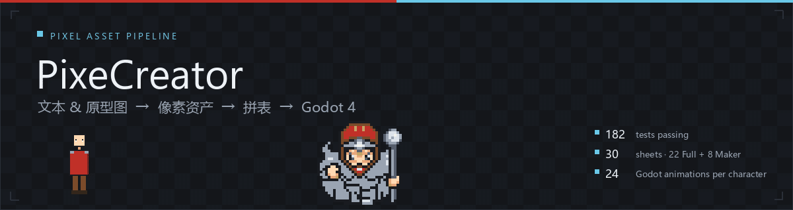
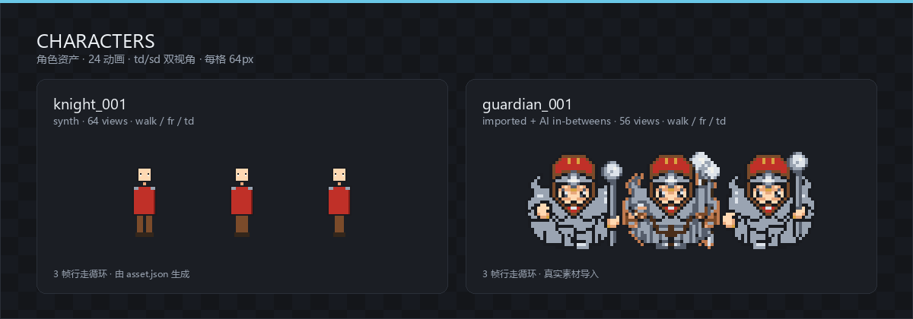
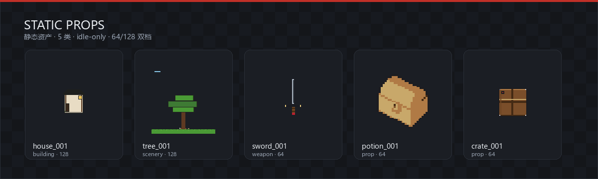
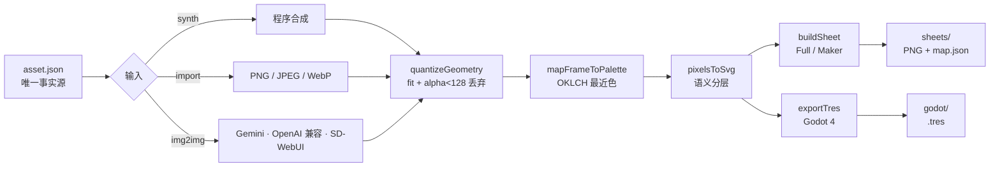

<p align="center">
  
</p>

<h1 align="center">PixeCreator</h1>

<p align="center">
  <b>文本或原型图进，像素资产出。</b><br/>
  一条本地、确定性、可复现的像素游戏资产管线：量化 → 色板 → 矢量视图 → 拼表 → Godot 4。
</p>

<p align="center">
  
  
  
  
  
  
</p>

PixeCreator 把"一张原型图"或"一句描述"变成可直接进引擎的像素资产：按色板量化、按语义分层矢量化、按动作拼表、一键导出 Godot `SpriteFrames`。整条链路本地运行，**同输入字节级一致**，不需要任何密钥；AI 生图是可选输入源，不是运行时依赖。

## Features

| | |
|---|---|
| 🎨 **三路输入**<br/>程序合成 · PNG/JPEG/WebP 页内框选导入 · img2img provider（Gemini / OpenAI 兼容 / SD-WebUI） | 🧱 **确定性管线**<br/>同输入字节级一致；生成物一律由工具再生成，禁止手改 |
| 🧩 **一动作一表**<br/>Full / Maker 双模式，td/sd 永不混表，行序固定 `fr/bk/lf/rt` | 🎮 **Godot 一键**<br/>`.tres` SpriteFrames，每角色 24 动画，region 与 `map.json` 逐格一致 |
| 🔒 **密钥不落地**<br/>provider key 只从环境变量读取；页面只见 provider 名，错误文本永不回显密钥 | 🧪 **默认不联网**<br/>182 个单测 + 7 套 web 验收 + Godot 配方自检，全部值断言 |
| 📐 **规范驱动**<br/>OpenSpec 冻结 specs、变更提案与归档；里程碑 M0–M5 全程可追溯 | 🖥️ **页内创作台**<br/>资产库 / 导入 / 导出 / Prompt 四区；预览 → 确认 → 备份的两段写 |

## Showcase

<p align="center">
  
  <br/>
  <sub>knight_001（程序合成）与 guardian_001（真实导入 + AI 补帧）· 每格 64px · 以上为 <code>sheets/</code> 真实拼表裁切</sub>
</p>

<p align="center">
  
  <br/>
  <sub>五类静态资产 · idle-only · 64 / 128 双档 · 同一套色板与拼表管线</sub>
</p>

## Pipeline



> [!NOTE]
> **Hash 语义**：synth 槽记录 `prompt_hash`；导入 / AI 槽 `prompt_hash = null` 并记录 `source_hash`（源图 sha256 前 12 位），AI 中间帧两者皆 null。SVG 元数据会内嵌 asset.json 的 hash，因此 **hash 必须先定稿，再导入 / 重生成**。

## Quick Start

要求 Node 20+（开发验证于 Node 24），唯一运行依赖 `pngjs`；核心工具与 `web/lib/*` 零第三方依赖。

```bash
# 1. 安装
npm ci

# 2. 启动本地创作台（只监听 127.0.0.1）
node tools/server.mjs --port 3000

# 3. 浏览器打开
# http://127.0.0.1:3000/web/
```

- **不需要任何 key**：无 provider 时 AI 编排按钮显式禁用，手动导入路径始终可用。
- 只读浏览可用任意静态服务器（如 `npx serve .`）；上传、生成、导出必须走 bridge。
- 跑测试：`node --test tools/*.test.mjs`（当前 182 个）。

## Web Workshop

| 区域 | 用途 |
|---|---|
| **资产库** | 卡片墙 + 矩阵播放（td/sd 切换）、行走/攻击预览、AI 补帧与 td 派生入口 |
| **导入** | PNG/JPEG/WebP 页内框选 → 量化前后对比 → 两段写导入 |
| **导出** | 校验、重生成（可单 clip）、拼表、`.tres`，结果内嵌可见 |
| **Prompt** | kind-aware 表单 → 英文 positive / negative / seed / `prompt_hash` |

- 所有写操作统一 **预览（零落盘）→ 确认 → 自动备份到 `.backup/`**；进度走 SSE。
- 桥作业串行、TTL 10 分钟、上限 100 个；确认令牌过期返回 410。
- 静态白名单：`/web/` `/assets/` `/sheets/` `/palettes/` `/fixtures/` `/godot/` `/tools/` `/prototypes/`。

<details>
<summary><b>Bridge API</b></summary>

| 端点 | 用途 |
|---|---|
| `GET /api/health` | 存活探测 |
| `POST /api/validate` | 校验资产（含落盘文件） |
| `POST /api/generate` | 重生成 SVG（可带 clip 参数） |
| `POST /api/sheet/export` | 导出拼表 |
| `POST /api/tres/export` | 导出 `.tres` |
| `POST /api/import` | 导入 PNG（JPEG/WebP 在浏览器转 PNG 后提交） |
| `GET /api/img2img/status` | 已配置 provider 名（不回显密钥 / URL） |
| `POST /api/img2img/inbetween` | guardian walk/attack 补帧（2→3） |
| `POST /api/img2img/derive-td` | 派生 td 真源 |
| `POST /api/jobs/:id/confirm` | 确认写入（先备份） |
| `GET /api/jobs/:id/events` | SSE 进度 |

</details>

## Asset Catalog

| 资产 | Kind | Size | 结构 | 来源 / hash |
|---|---|---|---|---|
| `knight_001` | character | 64 | 24 动画 / 64 视图 + 2 母版 | synth 样例；`prompt_hash` 64 槽真值 |
| `guardian_001` | character | 64 | 24 动画 / 56 视图 + 2 母版（idle 1f / walk 3f / attack 3f） | 真实导入 + AI 中间帧；`source_hash` 40 槽真值、16 mid 槽 null |
| `sword_001` | weapon | 64 | idle-only，8 视图 + 2 母版 | synth |
| `house_001` | building | 128 | idle-only，8 视图 + 2 母版 | synth · 128 档 |
| `crate_001` | prop | 64 | idle-only，8 视图 + 2 母版 | synth |
| `tree_001` | scenery | 128 | idle-only，8 视图 + 2 母版 | synth · 128 档 |
| `potion_001` | prop | 64 | idle-only，8 视图 + 2 母版 | 用户导入 `I_Bottle03`；`source_hash` 8 槽真值 |

> `guardian_001` 的 td/mid 目前是**正立的水平镜像离线占位**（`tdProvenance.mode = offline-standin-mirror`）；配置 provider 后执行“派生俯视角”即自动换代。

## Commands

<details>
<summary><b>自检（只读）</b></summary>

```bash
node --test tools/*.test.mjs                    # 全量单测（182）
node web/verify-1.1.mjs                         # 以下 7 个 web 验收
node web/verify-4.1.mjs
node web/verify-4.2.mjs
node web/verify-5.2.mjs
node web/verify-static.mjs
node web/verify-real-import.mjs
node web/verify-bridge.mjs
node engine-placeholder/godot-atlas/verify-recipe.mjs

node tools/asset-manifest.mjs validate assets/guardian_001/asset.json --check-files
node tools/palette.mjs validate palettes/*.v1.json
node tools/quantize.mjs selfcheck 64
```

</details>

<details>
<summary><b>生成（写产物）</b></summary>

```bash
node tools/vectorize.mjs generate --asset knight_001
node tools/sheet.mjs export --asset knight_001 --out sheets
node tools/tres.mjs export --asset knight_001
node tools/import-prototype.mjs --asset potion_001 --src prototypes/potion_001/input.png
node tools/backfill-hashes.mjs                  # knight prompt_hash 回填（幂等维护脚本）
```

</details>

## Image Providers

可选。未配置时页面编排按钮显式报错，手动导入不受影响；密钥只存在于服务端环境变量，仓库与页面零密钥。

| 变量 | 说明 |
|---|---|
| `PIXE_IMG_PROVIDER` | `gemini` \| `openai` \| `sd-webui`（只设 key 不算已配置） |
| `PIXE_IMG_KEY` | 云端 provider 密钥（gemini / openai） |
| `PIXE_OPENAI_BASE` / `PIXE_OPENAI_EXTRA` | OpenAI 兼容端点的可选覆盖（base / 额外 JSON） |
| `PIXE_SD_URL` | 本地 SD-WebUI 服务地址（无 key） |

能力边界（denoise / seed 退化、离线回落、AI 帧采纳原则）见 [`docs/img2img.md`](docs/img2img.md)。

## Design Rules

1. **`assets/*/asset.json` 是唯一事实源** —— SVG / PNG / map.json 一律由工具再生成，禁止手改。
2. **同输入字节级一致** —— 重构与优化以"生成物字节不变"为硬验收。
3. **AI 是导入源，不是运行时依赖** —— 采纳即提交，管线对提交输入保持确定；测试与 verify 永不联网。
4. **库里没有半成品** —— character 必须 24 格完整；创建是原子作业；缺格不可导出。
5. **密钥只在环境变量** —— 源码、示例、测试、页面都不含可用凭据。
6. **像素风一律最近邻** —— 前端 `imageSmoothingEnabled = false`，Godot 侧 `texture_filter = nearest`。

## Roadmap

| 里程碑 | 内容 | 状态 |
|---|---|---|
| **M0** | 人物管线首闭环（量化 → 矢量化 → 拼表 → 引擎占位） | ✅ 已归档 |
| **M1** | 多类资产 + Godot 配方 + OKLCH / Bayer + web 多资产 | ✅ 已归档 |
| **M2** | 真实素材导入 MVP（喂真图 → 出真资产） | ✅ 已归档 |
| **M3** | 一键 `.tres` + 128 档 + 真实角色 24 格 | ✅ 已归档 |
| **M4** | img2img 三层 provider + JPEG 框选 + 补帧 / td 真源 | ✅ 已归档 |
| **M5** | 文生像素素材：txt2img 三适配 + 动态注册 + 页内向导（静态 8 视图 / 角色 56 视图四阶段门） | 🔜 已立项 |

详细里程碑与遗留见 [`docs/milestones.md`](docs/milestones.md)。

## Documentation

| 文档 | 内容 |
|---|---|
| [`docs/milestones.md`](docs/milestones.md) | 里程碑 M0–M5 与下一步 |
| [`docs/agent-log.md`](docs/agent-log.md) | 逐轮开发 / 评审 / 合并记录 |
| [`docs/real-import.md`](docs/real-import.md) | 真实素材导入流程 |
| [`docs/img2img.md`](docs/img2img.md) | provider 配置、能力边界、离线回落 |
| [`docs/static-web.md`](docs/static-web.md) | 静态资产的 web 支持 |
| [`docs/quantize-compare.md`](docs/quantize-compare.md) | 量化对比说明 |
| [`docs/optimization-backlog.md`](docs/optimization-backlog.md) | 优化待办与已清项 |
| [`engine-placeholder/godot-atlas/IMPORT-RECIPE.md`](engine-placeholder/godot-atlas/IMPORT-RECIPE.md) | Godot 导入配方（gap #13–#24） |
| [`docs/launch-blocker-postmortem.md`](docs/launch-blocker-postmortem.md) | 启动阻塞事故复盘 |

## Workflow

项目采用规范驱动开发：

1. 在 `openspec/changes/<name>/` 写 `proposal.md` / `design.md` / `tasks.md` 与受影响的 spec delta。
2. 实现 + 全套自检绿；生成物在仓库外临时目录重跑并字节比对。
3. `--no-ff` 合并；提交格式 `type(scope): summary (task-id)`；归档后 specs 由 CLI 同步。

<p align="center">
  <sub>Built with Node.js &amp; pngjs · deterministic by default · no runtime network · no secrets in the repo</sub>
</p>
